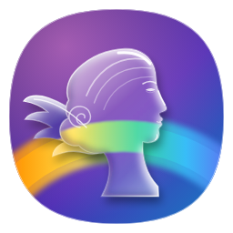
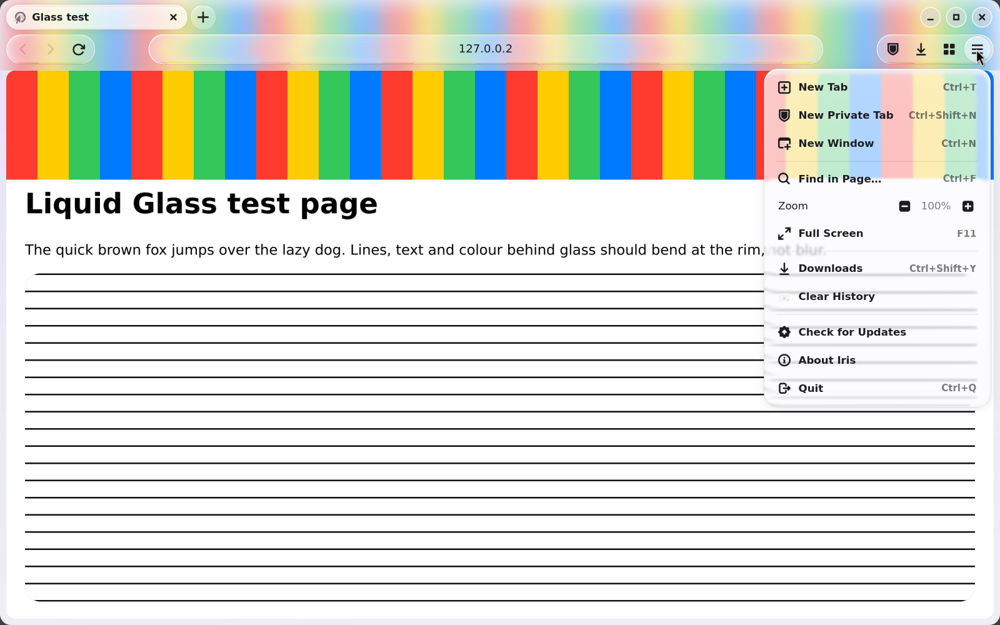
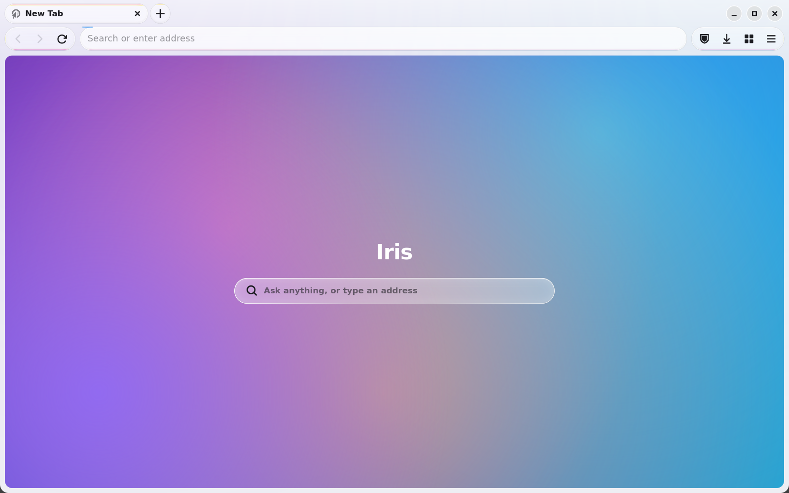
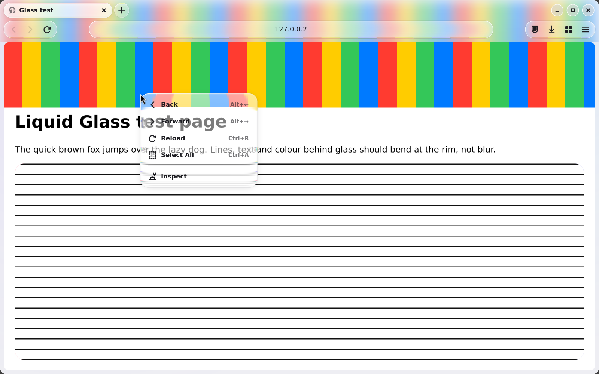

<p align="center">
  
</p>

<h1 align="center">Iris</h1>

<p align="center"><i>Iris is the Greek goddess of the rainbow, who carries light between worlds.</i></p>

<p align="center">
  <b>A browser made of glass.</b><br>
  Linux: Swift, libadwaita and WebKitGTK, in real Liquid Glass.<br>
  Android: Kotlin, Jetpack Compose and GeckoView. Every search asks Google AI Mode.
</p>

<p align="center">
  
  
  
  
  
</p>

<p align="center">
  <a href="#whats-new-in-200">New</a> ·
  <a href="#what-it-does">Features</a> ·
  <a href="#install">Install</a> ·
  <a href="#shortcuts">Shortcuts</a> ·
  <a href="#build">Build</a> ·
  <a href="#how-it-is-made">How it is made</a>
</p>

<p align="center">
  
</p>

---

## What's new in 2.0.0

Iris is made again from the start.

- **Linux in Swift.** swift-adwaita (GTK 4 and libadwaita), WebKitGTK for the pages, installed as a Flatpak.
- **Real Liquid Glass.** Not frosted glass: what lies behind stays sharp, and the glass bends it.
  - At the rim, the picture is pulled in from beyond the edge, with a touch of colour splitting.
  - A rim of light runs round each piece, and the pointer lights the glass where it is.
- **A translucent window.** Where the compositor offers background blur (niri 26.04 and newer, through `ext-background-effect-v1`), the desktop shows through it, blurred.
- **Springs.** Tabs slide into place. The selected tab's glass slides from tab to tab and stretches on the way. Menus open and close as glass.
- **Containers, worlds apart.** On both platforms, each container keeps its own cookies, storage, cache and sign-ins.
- **Ads open no tabs.** A pop-up needs your click, and goes only to the same site or a sign-in page. Anything else is stopped, with an Open button if you meant it.
- **Android in Kotlin with Jetpack Compose and GeckoView.** It has:
  - Firefox's engine with uBlock Origin built in;
  - a downloads manager;
  - pull down to reload;
  - updates from GitHub, installed over itself.
- **A new icon.** The goddess in liquid glass, rising out of her rainbow.
- **Fewer packages.** Windows, Nix, the Snap and the container image are gone. Linux ships as a Flatpak.

## What it does

### Linux

<p align="center">
  
  
</p>

- **Liquid Glass chrome.** The tabs, the address bar and the button groups float as glass.
  - The page's own colour reaches up under the toolbar (as Safari's does), so the glass has something to bend.
  - Menus, suggestions, find, downloads and notices are glass over the page itself.
- **Search.** Type an address, or anything else to ask Google AI Mode. Iris asks it to answer from high-quality, current sources. `yt cats` searches YouTube.
- **Containers.**
  - Personal, Work, Shopping and Banking to start with, and any you add.
  - Each is a WebKit network session of its own on disk.
  - Open a new tab in a container, or open the current page in another one.
  - Removing a container deletes everything its sites kept.
- **Private tabs.** One in-memory world, gone when the last private tab closes.
- **Iris Shields.** About 100,000 ad and tracker domains become WebKit content rules. They are compiled once and blocked inside the engine before a request leaves. You can turn Shields off for one site or everywhere.
- **Cookies stay home.** Third-party cookies are refused, and WebKit's tracking prevention is on.
- **Pop-ups.**
  - Links that open a new window open as a tab next to yours.
  - Script pop-ups need your click, and go only to the same site or a sign-in page.
- **Right click.** Iris's own glass menu:
  - links: open in a new tab or in a container, copy, download;
  - images and video: open, copy the address, save;
  - selected text: copy, or ask Google AI Mode about it;
  - text fields: cut, copy, paste, select all;
  - the page: back, forward, reload, inspect.
- **Downloads.** Saved to your Downloads folder, shown in a glass panel with progress. Open a file or show it in its folder.
- **The rest.**
  - Find in page and zoom.
  - Full screen for videos and with F11.
  - Your tabs come back next time.
  - A daily check for a newer Iris.
- **Sharp at every scale.** GTK draws everything, at 1.25, 1.5 or 2.

### Android

- **Engine.** GeckoView (Firefox's engine) with Jetpack Compose and Material 3. One engine runtime is shared by all tabs, and the tabs live in a ViewModel, so they survive rotation.
- **Containers.** Through GeckoView's `contextId`, each container keeps its own cookies, cache, localStorage and IndexedDB.
- **Shields.**
  - Firefox's strict tracking protection.
  - Total Cookie Protection.
  - Cookie banners refused.
  - uBlock Origin built in, with its filter lists one tap away.
- **Tabs.** A strip of tabs on top with one "+" (long-press it to pick a container). The bottom bar has back, forward, home, Shields, containers and downloads.
- **Downloads manager.** Files go to the phone's Downloads folder (no storage permission needed), with progress, open and delete.
- **Pull to reload** at the top of a page.
- **Auto-update.** Iris checks GitHub once a day, downloads the new APK and has Android install it over itself.
- **Closing tabs.** Closing the tab you are on opens the one beside it; closing the last tab leaves a fresh one.

## Install

**Linux (Flatpak):**

    flatpak install --user Iris-x86_64.flatpak

Download it from the [releases](https://github.com/Tulip-Labs/Iris-Browser/releases). It needs the GNOME 50 runtime, which Flatpak installs from Flathub.

On niri, the blur behind the window comes on by itself on 26.04 and newer. No window rule is needed.

**Android:** `Iris-android.apk` from the releases. It needs Android 10 or newer. After this install, Iris updates itself.

## Shortcuts

| Keys | Does |
|---|---|
| Ctrl+T / Ctrl+Shift+T | New tab / open the last closed tab again |
| Ctrl+Shift+N | New private tab |
| Ctrl+N | New window |
| Ctrl+W | Close tab |
| Ctrl+L, Ctrl+K, F6 | Address bar |
| Ctrl+Tab, Ctrl+Shift+Tab, Ctrl+1…9 | Change tab |
| Ctrl+R, F5 / Ctrl+Shift+R | Reload / reload without the cache |
| Alt+← / Alt+→ | Back / forward |
| Ctrl+F | Find in page |
| Ctrl+Plus / Ctrl+Minus / Ctrl+0 | Zoom |
| Ctrl+Shift+Y, Ctrl+J | Downloads |
| F11 | Full screen |
| Ctrl+Q | Quit |

## Build

**Linux.** You need Swift 6.3 and the development files of libadwaita, GtkSourceView 5, WebKitGTK 6 and libsoup 3.

    cd linux
    swift build -c release
    swift test
    .build/release/Iris

Or the Flatpak, as CI builds it:

    flatpak-builder --user --install --force-clean build packaging/flatpak/io.github.tulip_labs.Iris.yml

**Android.** You need JDK 21.

    cd android
    ./gradlew assembleRelease

The build fetches uBlock Origin from its GitHub release and bundles it.

To let updates install over Iris, sign every release with the same key. Put the keystore in the repository's secrets (`IRIS_KEYSTORE` as base64, `IRIS_KEYSTORE_PASSWORD`, `IRIS_KEY_ALIAS`); `.github/workflows/android.yml` uses them.

## How it is made

```
linux/                      Iris for Linux (Swift package)
  Sources/Iris/
    Stage.swift             the window's content: a GTK widget made in Swift that lays out
                            every piece and draws it in layers (back, pages, chrome, overlays)
    Glass.swift             Liquid Glass from GTK render nodes: lens, rim refraction in three
                            steps, dispersion, rim light, pointer light
    Motion.swift            springs, and the liquid stretch of the sliding tab
    Browser.swift           a window: tabs, address, toolbar, pop-up rules, layout
    Tab.swift               a WebKit web view and its signals
    Containers.swift        one WebKit network session per container
    Shields.swift           the block list as WebKit content rules
    Overlays.swift          menus, suggestions, find, downloads, the right-click menu
    NewTab.swift, Keys.swift, Downloads.swift, History.swift, Updates.swift, Search.swift
  Sources/CBlur/            ext-background-effect-v1: blur behind the window
android/                    Iris for Android (Kotlin, Compose, GeckoView)
  app/src/main/java/org/tulipanlabs/iris/
    IrisApp.kt              the one GeckoRuntime, Shields, uBlock Origin
    Browser.kt              tabs and their GeckoSessions in a ViewModel, pop-up rules
    ui/                     Compose: tab strip, address, page (GeckoView in AndroidView),
                            pull to reload, sheets, downloads manager, prompts
    Downloads.kt, Updater.kt, Store.kt, Search.kt, Prompts.kt
packaging/                  the Flatpak manifest, desktop file and metainfo
assets/icon/                the icon (SVG) and its renders
```

How the glass is drawn: each frame, the window first draws everything behind the glass (its tint and the page) into one scene. It then draws each piece of glass over that scene:

- a slightly magnified copy of what lies behind;
- three copies pulled in from beyond the edge, each seen only through a mask that fades in towards the rim, so lines curve as they cross it;
- red and blue split a little at the outermost step;
- a faint tint, the rim of light and the pointer's light.

Every step is a GTK render node (clip, transform, mask, blend, colour matrix, gradients), so it runs on GTK's GL and Vulkan renderers alike, at any scale.

## License

GPL 3.0. See [LICENSE](LICENSE), [NOTICE](NOTICE), [PRIVACY.md](PRIVACY.md) and [THIRD_PARTY_NOTICES.md](THIRD_PARTY_NOTICES.md).
