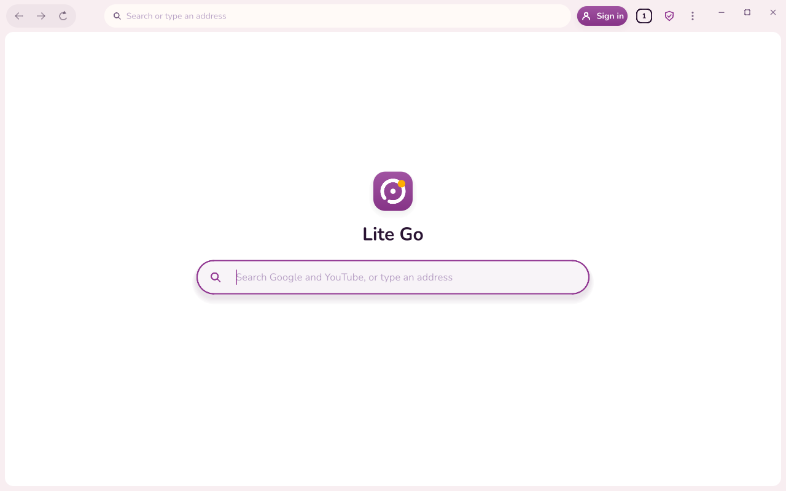
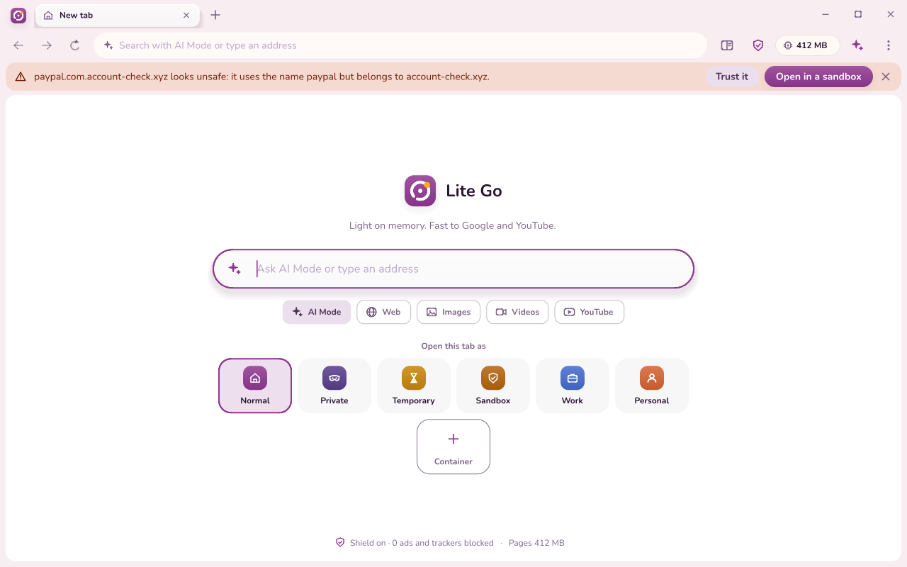
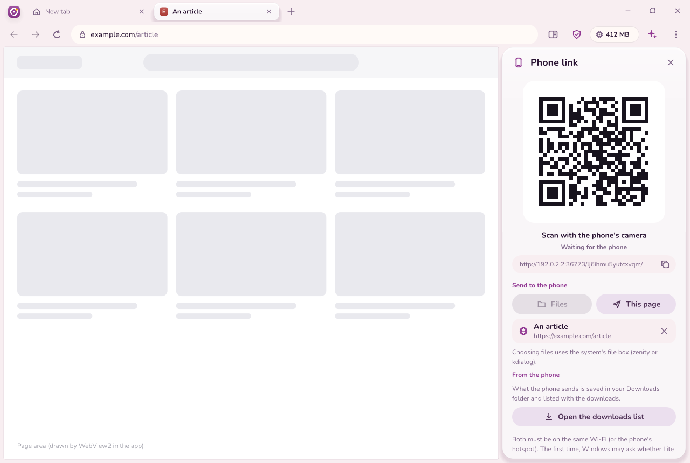
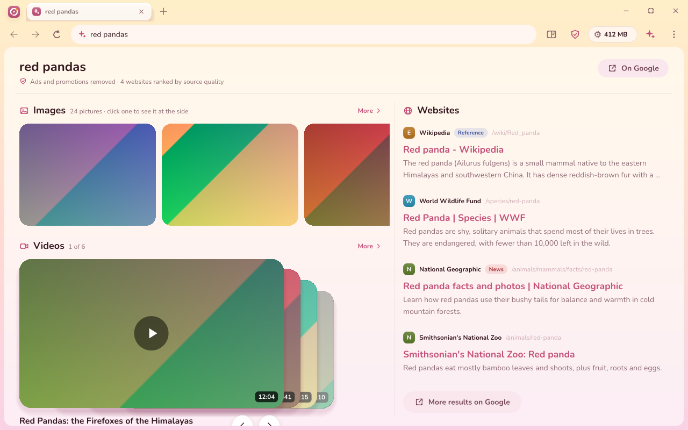
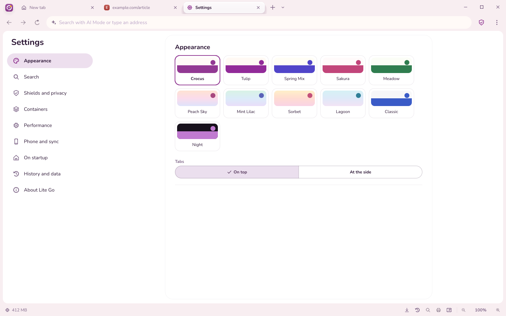
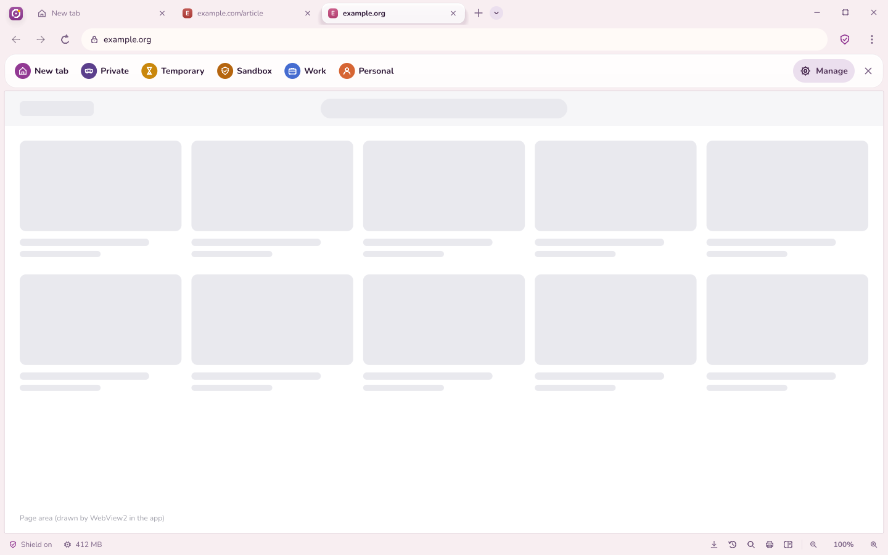

<p align="center">
  
</p>

<h1 align="center">Lite Go</h1>

<p align="center">
  <b>A light, fast browser written in Go.</b><br>
  The interface is drawn with Gio. Pages are shown by the web view your system already has.
</p>

<p align="center">
  
  
  
  
  
</p>

<p align="center">
  <a href="#what-it-does">Features</a> ·
  <a href="#shortcuts">Shortcuts</a> ·
  <a href="#platforms">Platforms</a> ·
  <a href="#build">Build</a> ·
  <a href="#how-it-is-made">How it is made</a>
</p>

<p align="center">
  
</p>

---

## Why Lite Go

Most browsers ship a whole web engine and then spend your memory on it. Lite Go ships none.
It uses the engine the system keeps up to date (WebView2 on Windows, WebKitGTK on Linux) and
puts a small Go program around it that decides what each page may cost.

<table>
<tr>
<td width="33%" valign="top">

**Light**

Background tabs give memory back at once, sleep, then unload. A balancer keeps the computer's resources on what you are using.

</td>
<td width="33%" valign="top">

**Fast**

It stays ready in the background, so the window opens on click. The new tab page is drawn
by Lite Go itself, and a page is prepared while you type.

</td>
<td width="33%" valign="top">

**Clean**

Ads, trackers, cookie notices and tracking links are removed. Google searches are shown on
a page of Lite Go's own, in your theme. No bookmarks, no tiles, no feeds.

</td>
</tr>
</table>

## A look

<table>
<tr>
<td width="50%"></td>
<td width="50%"></td>
</tr>
<tr>
<td align="center"><sub><b>New tab.</b> Search, and what kind of tab this is.</sub></td>
<td align="center"><sub><b>Split view.</b> Two pages, one divider to drag.</sub></td>
</tr>
<tr>
<td width="50%"></td>
<td width="50%"></td>
</tr>
<tr>
<td align="center"><sub><b>Downloads.</b> A ring on the icon, a list at the side.</sub></td>
<td align="center"><sub><b>Sandbox.</b> Unsafe addresses are stopped first.</sub></td>
</tr>
<tr>
<td width="50%"></td>
<td width="50%"></td>
</tr>
<tr>
<td align="center"><sub><b>Phone link.</b> Scan the code, move files both ways.</sub></td>
<td align="center"><sub><b>Sorbet.</b> One of four pastel palettes that merge three colors.</sub></td>
</tr>
<tr>
<td width="50%"></td>
<td width="50%"></td>
</tr>
<tr>
<td align="center"><sub><b>Settings.</b> A page of its own, with a status bar below.</sub></td>
<td align="center"><sub><b>The + menu.</b> Private, temporary, sandbox and container tabs.</sub></td>
</tr>
</table>

<table>
<tr>
<td width="33%"></td>
<td width="33%"></td>
<td width="33%"></td>
</tr>
<tr>
<td align="center"><sub><b>Lite for Android.</b> Lite results.</sub></td>
<td align="center"><sub>Eleven palettes.</sub></td>
<td align="center"><sub>Hold + for private and container tabs.</sub></td>
</tr>
</table>

<sub>The desktop pictures are drawn by the test suite with Lite Go's software renderer (page areas
and thumbnails are placeholders); the Android ones come from an emulator.</sub>

## What it does

### Browsing

| | |
|---|---|
| **Lite results** | Google searches on Lite Go's own page: a picture carousel, a stack of video cards, the AI Mode answer with its sources, and the websites ranked by source quality (references, official sites and docs rise; shops, coupon farms and listicles sink). "On Google" shows the original. |
| **Search modes** | AI Mode (default), Web, Images, Videos and YouTube. Type `yt ` before words to search YouTube from any mode. |
| **Ask AI** (Ctrl+J) | On any page, a side panel sends your question and the page's text (or your selection) to Google AI Mode and writes the answer with its sources. No API key. |
| **Split view** | Two pages side by side. The pane you click takes the keyboard and the address bar. |
| **Downloads** | A toolbar icon with a progress ring; a list with speed, time left, pause, resume, cancel, open and show in folder. |
| **Phone link** | Move photos and files between the computer and a phone with nothing to install on the phone: Lite Go shows a QR code, the phone scans it and uses its own browser to send files (they land in Downloads) or take the ones you offer, or the page you are on. Same Wi-Fi only; the address carries a random key and works only while the link is on. The connection is not encrypted, so it is for networks you trust. |
| **Proton Pass** | Your passwords in the side panel, beside the page you are on, kept signed in (from the menu). It is the Proton Pass site itself; Lite Go reads nothing from it. |
| **Status bar** | Along the bottom, as in Vivaldi: what the shield blocked, the memory the pages use, downloads, history, find, print, split view and zoom. |
| **Settings** | A page of their own, like Chromium's, with the sections at the left: appearance, search, shields and privacy, containers, performance, phone and sync, startup, history and about. |
| **Sync with Android** | History, open tabs and the palette stay the same on the computer and Lite for Android, with no account and no server: the two trade directly when they are on the same Wi-Fi, sealed with AES-256 under a key only they share. Pair from Menu, Phone. |
| **The usual** | Find in page, zoom, print, a searchable history by day, reopen a closed tab, and the last tabs brought back at start (unloaded until you open them). |
| **Tabs** | On top or at the side. The arrow beside the + button (or a right-click on it) opens private, temporary, sandbox and container tabs, as in Brave. Containers keep their own sign-ins, each with an icon and a color you choose under Settings, Containers. |

### Memory

| | |
|---|---|
| **The plan** | Background tabs are hidden at once, put to sleep after a while and unloaded later, keeping their address and title. Tabs playing sound stay awake. Saver, Balanced and Speed profiles follow the computer's RAM. |
| **The balancer** | The tab in front (both, in split view) has priority. Every other page is told at once that nobody is looking, so the engine gives memory back. When the pages pass the budget, or the computer runs short, background pages sleep and then unload, oldest first. |

### Lite Shields

| | |
|---|---|
| **Filter lists** | EasyList, EasyPrivacy and uBlock filters, about 110,000 rules matched in microseconds, refreshed every few days, plus a built-in list of 100,000 domains. |
| **Adaptive** | A site is scanned on its first visits. Where three scans find nothing, the shield stands by and the site's requests go straight to the network; where something is found, it stays on. Clean sites are scanned again every 15 visits or three days. |
| **What ads leave behind** | Empty boxes and cookie notices are hidden. Tracking parameters are cut from links, tracking redirects skipped, AMP pages opened at the source. |
| **Fingerprinting** | Canvas, audio and hardware details vary slightly per site and session. Sign-in and human-check pages are left alone. |
| **Never broken** | Sign-in, messaging, human checks and YouTube playback are never blocked. Pictures, video, style sheets and fonts always load: the shield checks scripts and data requests, where ads and trackers start, and never blocks a whole hosting network. |

### Safety

| | |
|---|---|
| **HTTPS-only** | Addresses go straight to HTTPS. A site without it is stopped before it loads. |
| **Sandbox** | A site without HTTPS, or an address that looks dangerous (a known name on someone else's site, a real site hidden behind an `@`, a bare network address, look-alike letters), can be opened in a throwaway session: no downloads, no camera, microphone, location, notifications or clipboard, nothing saved, wiped when the tab closes. The check reads the address only; it is not a malware scanner. |
| **Checks itself** | At every start Lite Go compares its program file with the SHA-256 recorded at install and warns if they differ. This catches accidents and careless changes. The Store package is stronger: Windows keeps it read-only and verifies it. |
| **Private by kind** | Private tabs share one session never written to disk. A temporary tab is a fresh session of its own. History is never kept for either. |

## Shortcuts

| Keys | Action | Keys | Action |
|---|---|---|---|
| `Ctrl` `T` | New tab | `Ctrl` `F` | Find in page |
| `Ctrl` `Shift` `N` | Private tab | `Ctrl` `H` | History |
| `Ctrl` `W` | Close tab | `Ctrl` `P` | Print |
| `Ctrl` `Shift` `T` | Reopen closed tab | `Ctrl` `Shift` `S` | Split view |
| `Ctrl` `L` | Address bar | `Ctrl` `Shift` `D` | Downloads |
| `Ctrl` `J` | Ask AI | `Ctrl` `+` `-` `0` | Zoom |
| `Ctrl` `Tab` | Next tab | `Ctrl` `M` | Mute tab |
| `Ctrl` `1`...`9` | Go to tab | `Alt` `Left` / `Right` | Back, forward |
| `Ctrl` `R` / `F5` | Reload | `F11` | Full screen |
| `Ctrl` `Shift` `L` | Phone and sync | `Ctrl` `,` | Menu |

They work while a page has the keyboard too.

## Platforms

| System | Web engine | Status |
|---|---|---|
| Windows 10 and 11 (x64, ARM64) | Microsoft Edge WebView2, through Lite Go's own bindings in pure Go (no cgo) | Runs. The newest features (downloads, split view, sandbox, phone link) are covered by tests with a stand-in engine and still need a pass on a real PC. |
| Linux: native Wayland and X11 (GNOME, KDE, niri and others) | WebKitGTK 4.1, in a GTK window | Built and started on Debian 12 and 13, Ubuntu 22.04 and 24.04, Fedora 42 and 43, openSUSE Tumbleweed and Arch on every push. Packages: .deb, .rpm, Flatpak, AUR, Nix and .tar.gz. |
| Android 8 and newer | Android System WebView | **Lite for Android**, a separate app in Kotlin (`android/`): shields, Lite results for Web searches, tabs, containers (WebView 123 or newer), eleven palettes, phone and tablet layouts, and sync with the computer. `Lite-android.apk` is in each release. |

No engine is bundled: each comes with the system and is kept up to date by it.

On Linux the window is a GTK window, because Wayland does not let one program's surface sit
inside another's. GTK owns the window, Gio's GPU renderer draws the interface into a GL area
in it, and each page's WebKitWebView sits over that area. One window, one connection to the
display.

## Install on Linux

Every release has a `.deb`, an `.rpm`, a Flatpak bundle and a `.tar.gz` for any distribution. Lite Go needs glibc 2.35 or newer (Debian 12, Ubuntu 22.04, Fedora 36 or later).

**Debian, Ubuntu, Linux Mint** (from the repository, so updates come with the system's):

```sh
echo "deb [trusted=yes] https://tulip-labs.github.io/Lite-Go-Browser/deb stable main" | sudo tee /etc/apt/sources.list.d/lite-go-browser.list
sudo apt update && sudo apt install lite-go-browser
```

**Fedora**

```sh
sudo dnf config-manager addrepo --from-repofile=https://tulip-labs.github.io/Lite-Go-Browser/lite-go-browser.repo
sudo dnf install lite-go-browser
```

**openSUSE**

```sh
sudo zypper addrepo https://tulip-labs.github.io/Lite-Go-Browser/lite-go-browser.repo
sudo zypper install lite-go-browser
```

**Fedora Atomic** (Silverblue, Kinoite): `sudo curl -fsSLo /etc/yum.repos.d/lite-go-browser.repo https://tulip-labs.github.io/Lite-Go-Browser/lite-go-browser.repo`, then `rpm-ostree install lite-go-browser`. Or use the Flatpak.

**Flatpak** (any distribution): download `LiteGo-x86_64.flatpak` from the release, then `flatpak install --user LiteGo-x86_64.flatpak`.

**Arch**: the `PKGBUILD` in each release builds the package `lite-go-browser-bin` (`makepkg -si`).

**Nix**: `nix profile install github:Tulip-Labs/Lite-Go-Browser`, or try it with `nix run github:Tulip-Labs/Lite-Go-Browser`.

**Any distribution, no root**: unpack `LiteGo-linux-x86_64.tar.gz` and run `./install.sh` (it installs to `~/.local`).

The repository pages with these commands are at [tulip-labs.github.io/Lite-Go-Browser](https://tulip-labs.github.io/Lite-Go-Browser/).

**Updates.** Lite Go checks the latest GitHub release every few hours (Settings, About Lite Go; on by default) and checks each download against the release's `SHA256SUMS`. The `.tar.gz` and Flatpak copies update by themselves; `.deb` and `.rpm` copies download in the background and install with one click and your password. Copies from the AUR, Nix or rpm-ostree update the way those tools do.

## Build

**Windows.** Double-click `build-litego.bat`. It installs Go with winget if needed, runs the
tests and makes:

| File | What it is |
|---|---|
| `dist\Lite Go Setup.exe` | The installer: current user only, no administrator rights |
| `dist\Lite Go\Lite Go.exe` | The portable app (also `dist\LiteGo-portable.zip`) |
| `dist\LiteGo.msixbundle` | For the Microsoft Store, packed without the Windows SDK |

No C compiler is needed, and builds stay well under 2 GB of memory.

**Linux.** On Linux, `./build-litego.sh` builds Lite Go for Linux first and then the Windows
files. It checks for the build tools and WebKitGTK development files and says what to install if
something is missing:

```sh
# Fedora
sudo dnf install gcc pkgconf gtk3-devel webkit2gtk4.1-devel libepoxy-devel
# Fedora Atomic (Silverblue, Kinoite): build inside a toolbox
toolbox create && toolbox enter   # then the Fedora line above
# Debian, Ubuntu
sudo apt install gcc pkg-config libgtk-3-dev libwebkit2gtk-4.1-dev libepoxy-dev
# Arch
sudo pacman -S gcc pkgconf gtk3 webkit2gtk-4.1 libepoxy

./build-litego.sh             # Linux (dist/linux, dist/LiteGo-linux-x86_64.tar.gz), then Windows
./build-litego.sh linux       # Linux only
./build-litego.sh windows     # Windows only
./build-litego.sh install     # build for Linux and install for you: ~/.local/bin and the app list
./build-litego.sh uninstall
```

Each release also has `LiteGo-linux-x86_64.tar.gz`: unpack it and run `./install.sh`. It needs
WebKitGTK 4.1 on the system (most desktops have it; on Fedora Atomic, `rpm-ostree install webkit2gtk4.1`
if it is missing).

**Tests.**

```sh
go test ./core ./shell ./shields ./ui
SHOTS=shots go test ./shell   # also writes screenshots of every screen
```

<details>
<summary><b>Getting it onto other PCs without warnings</b></summary>

<br>

Windows warns about programs not signed by a known publisher. For a free app
the clean route is the Microsoft Store:

1. Registration is free for individual developers: create an account in Partner Center.
2. Reserve the name "Lite Go", then copy *Package/Identity/Name* and *Publisher* from
   Product identity into `packaging/msix.json`.
3. Build and upload `dist\LiteGo.msixbundle`. The Store signs it, so it installs without
   warnings and updates itself.

The whole submission, with the listing texts, is in [packaging/STORE.md](packaging/STORE.md).

`packaging/test-install.ps1` signs a package with a certificate made on your own PC, to try
the MSIX first. The setup `.exe` and the portable app stay unsigned: SmartScreen shows
"Windows protected your PC" (More info, Run anyway) until a code-signing certificate is
used, which is a paid service.

</details>

## How it is made

```
cmd/litego          the program: window, resident process, system hooks
    |
  shell             the interface: tabs, split view, address bar, new tab page,
    |               results, downloads, history, the balancer, the side panel
    |
    +-- ui, giox    the interface toolkit (Material 3, liquid glass) and its Gio backend
    +-- core        rules with no window: search, shields, adaptive scans, unsafe
    |               addresses, HTTPS, the memory plan, history, settings
    +-- shields     filter lists, hiding rules, link cleaning, fingerprinting
    +-- link        the phone link: a small server on the local network
    +-- webview     one small interface over two engines:
                      WebView2 from pure Go (COM vtables, profiles, sandbox, suspend,
                      request filtering, downloads)
                      WebKitGTK through cgo
```

| Folder | What it is |
|---|---|
| `setup`, `cmd/litego-setup` | The installer: its screens, install, update and removal |
| `raster` | A software renderer, for tests and screenshots |
| `packaging`, `tools` | MSIX packing and build helpers |

The web engine sits behind `webview.Engine` and `webview.View`, so everything above it is
the same on both systems, and the whole interface can be tested with a stand-in engine.

## License

[GNU General Public License 3.0](LICENSE). You may use, share and change Lite Go, and sell
copies; copies and changed versions must keep the copyright notice, stay under the GPL and
come with their source. See also [NOTICE](NOTICE) and
[THIRD_PARTY_NOTICES.md](THIRD_PARTY_NOTICES.md). What Lite Go does with data: [PRIVACY.md](PRIVACY.md).

<p align="center">
  <sub>Tulipan Labs · Cesar Jose Luis Torrecilla Gelvez</sub>
</p>
