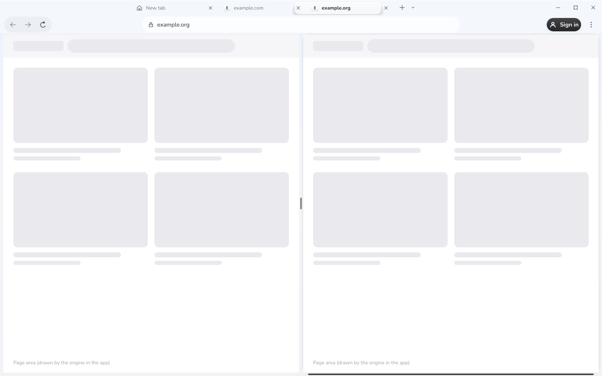
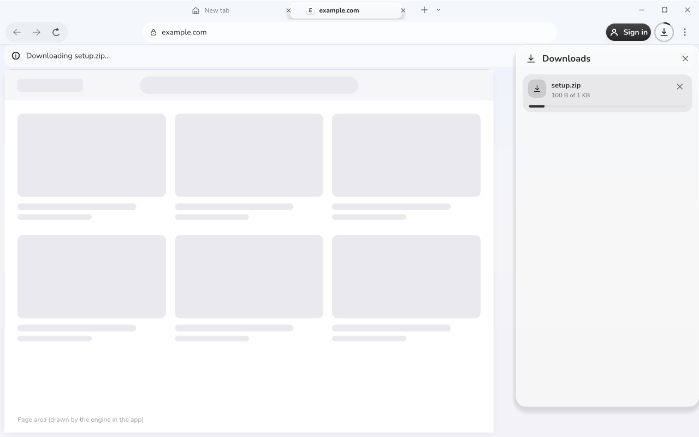
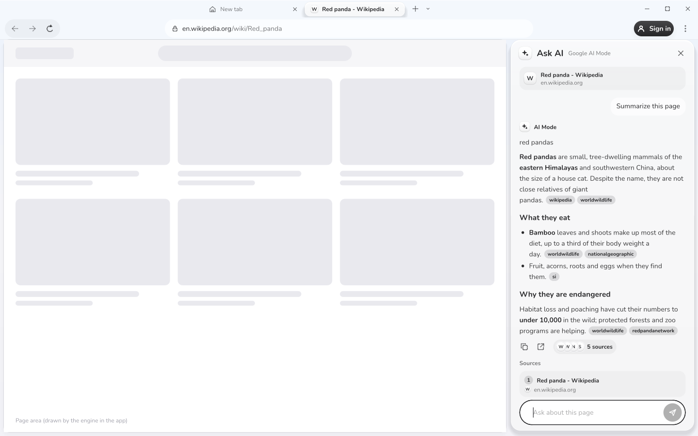
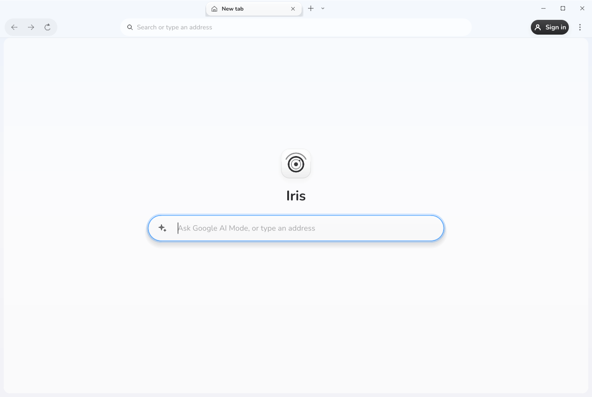
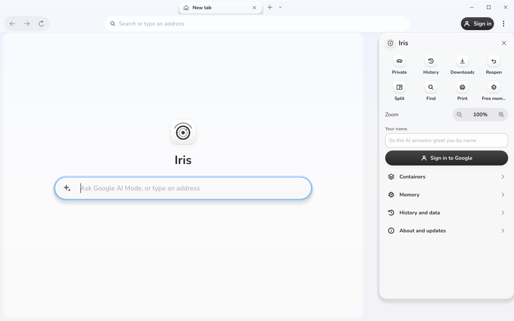
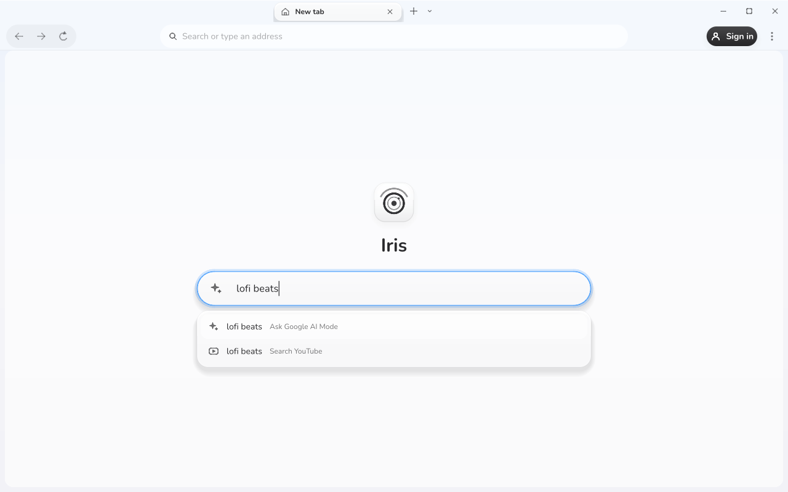

<p align="center">
  
</p>

<h1 align="center">Iris</h1>

<p align="center"><i>Formerly Lite Go. Iris is the Greek goddess of the rainbow, who carries light between worlds.</i></p>

<p align="center">
  <b>A light, fast browser written in Go.</b><br>
  One light Liquid Glass interface, drawn with Gio and sharp at every display scale.<br>
  For Linux (pages by WebKitGTK) and Android. Every search asks Google AI Mode.
</p>

<p align="center">
  
  
  
  
  
</p>

<p align="center">
  <a href="#whats-new-in-1026">New</a> ·
  <a href="#what-it-does">Features</a> ·
  <a href="#shortcuts">Shortcuts</a> ·
  <a href="#platforms">Platforms</a> ·
  <a href="#build">Build</a> ·
  <a href="#how-it-is-made">How it is made</a>
</p>

<p align="center">
  
</p>

---

## What's new in 1.0.26

- **Linux: WebKitGTK for every page.** One engine, the one GNOME Web uses: YouTube, social sites and web apps included. Electron and the cookie bridge are gone, and Iris for Linux is about 17 MB instead of about 300 MB.
- **Iris is for Linux and Android.** Iris for Windows ends with 1.0.25; its downloads stay on that release.
- **One look, no backgrounds.** Light Liquid Glass over the theme's own pale wash, on Linux and on Android. The background pictures and their menu are gone.
- **No browser extensions.** WebKitGTK does not run Chrome extensions; Iris Shields block ads, trackers and cookie notices without them.
- **Lighter container image** for Podman and Docker, with WebKitGTK only.

What came in 1.0.25 (Liquid Glass, every search in Google AI Mode, the tab strip on Android) is in the [release notes](packaging/release-notes.md).

## Why Iris

Most browsers spend your memory on their web engine without asking what each page is worth.
Iris puts a small Go program around WebKitGTK that decides what each page may cost: tabs
in the background rest and unload, and nothing runs once the window closes.

<table>
<tr>
<td width="33%" valign="top">

**Light**

A background tab rests within a minute: its page closes and its memory goes back, and it comes back where you left it. A closed tab frees its memory at once. Nothing runs in the background.

</td>
<td width="33%" valign="top">

**Fast**

Compact tabs on top, one slim bar under them, and a new tab page drawn by Iris itself:
the name and a search, nothing else.

</td>
<td width="33%" valign="top">

**Clean**

Ads, trackers, cookie notices and tracking links are removed. Every search is answered by
Google AI Mode from the best current sources. No bookmarks, no tiles, no feeds.

</td>
</tr>
</table>

## A look

<table>
<tr>
<td width="50%"></td>
<td width="50%"></td>
</tr>
<tr>
<td align="center"><sub><b>New tab.</b> The name and a search.</sub></td>
<td align="center"><sub><b>Split view.</b> Two pages, one divider to drag.</sub></td>
</tr>
<tr>
<td width="50%"></td>
<td width="50%"></td>
</tr>
<tr>
<td align="center"><sub><b>Downloads.</b> A ring on the icon, a list at the side.</sub></td>
<td align="center"><sub><b>Sandbox.</b> Unsafe addresses are stopped first.</sub></td>
</tr>
<tr>
<td width="50%"></td>
<td width="50%"></td>
</tr>
<tr>
<td align="center"><sub><b>Ask AI.</b> Google AI Mode beside any page, with its sources.</sub></td>
<td align="center"><sub><b>Tabs.</b> A compact strip on top, centered.</sub></td>
</tr>
<tr>
<td width="50%"></td>
<td width="50%"></td>
</tr>
<tr>
<td align="center"><sub><b>The menu.</b> Tools, then the settings in sections that open in place.</sub></td>
<td align="center"><sub><b>Search.</b> Every search asks Google AI Mode.</sub></td>
</tr>
</table>

<sub>The desktop pictures are drawn by the test suite with Iris's software renderer (page areas
and thumbnails are placeholders) and refreshed by CI (`.github/workflows/screens.yml`) whenever
the interface changes. Iris for Android's pictures come from an emulator
(`.github/workflows/android-screens.yml`, kept on the `android-screens` branch).</sub>

## What it does

### Browsing

| | |
|---|---|
| **Search** | Words typed in the address bar or on the new tab page open Google AI Mode in the tab, with a short instruction after them: answer from high-quality, authoritative and up-to-date sources (official sites, documentation, peer-reviewed research, reputable news), cite them, and be clear, precise and concise. The address bar and the tab show only your words. Type `yt ` before words to search YouTube. |
| **The look** | Liquid Glass, light: frosted white panes with bright rims over a pale wash, near-black text, colorless glass controls, and Apple's system blue only for the ring around what has the keyboard. One look, nothing to pick. |
| **Websites in new tabs** | A result, an address typed while a site is open, or a link to another website opens in a new tab beside the one you are on. Back from its first page (or closing it) returns there. Sign-in steps stay in their tab. |
| **Ask AI** (Ctrl+J) | On any page, a side panel sends your question and the page's text (or your selection) to Google AI Mode and writes the answer with its sources. No API key. |
| **Split view** | Two pages side by side. The pane you click takes the keyboard and the address bar. |
| **Downloads** | A toolbar icon with a progress ring; a list with speed, time left, pause, resume, cancel, open and show in folder. |
| **One slim bar** | Back, forward and reload at the left, the address in the middle, then the shield and the menu. It narrows to what is needed on a small window. A Sign in button shows only while Iris is not signed in to Google. |
| **The menu** | Tools (private tab, history, downloads, reopen, split view, find, print, free memory), zoom, your name for the AI answers, and the settings in sections that open in place: containers, memory, history and data, about and updates. |
| **The usual** | Find in page, zoom, print, a searchable history by day, reopen a closed tab, and the last tabs brought back at start (unloaded until you open them). |
| **Tabs** | A compact strip on top, centered, above the bar; tabs shrink to their icons as more open, and the strip scrolls with the wheel when they do not fit. The arrow beside + opens private, temporary, sandbox and container tabs. Containers keep their own sign-ins, each with an icon and a color. |

### Memory

| | |
|---|---|
| **The plan** | Background tabs are hidden at once and rest soon after (20 seconds on Saver, a minute on Balanced, ten on Speed): the page closes and gives its memory back, keeping its address, title and scroll position, so it comes back where it was (hydration). A closed tab frees its memory at once. Tabs playing sound or video (and for ten minutes after they pause) and YouTube tabs never rest. A hidden WebKit page keeps its memory, so under pressure Iris unloads background pages rather than only hiding them. Nothing is prepared ahead of time and nothing keeps running once the window closes. |
| **The balancer** | The tab in front (both, in split view) has priority. When the pages pass the budget, or the computer runs short, background pages unload, oldest first. |

### Iris Shields

| | |
|---|---|
| **Filter lists** | EasyList, EasyPrivacy and uBlock filters, refreshed every few days, plus a built-in list of domains, compiled into WebKit's content blockers: WebKit matches them itself before a request leaves. |
| **Adaptive** | A site is scanned on its first visits. Where three scans find nothing, the shield stands by and the site's requests go straight to the network; where something is found, it stays on. Clean sites are scanned again every 15 visits or three days. |
| **What ads leave behind** | Empty boxes and cookie notices are hidden. Tracking parameters are cut from links, tracking redirects skipped, AMP pages opened at the source. |
| **Fingerprinting** | Canvas, audio and hardware details vary slightly per site and session. Sign-in and human-check pages are left alone. |
| **Videos** | WebKit plays video through GStreamer: VP9, AV1 and VP8 with Opus and Vorbis (YouTube and most sites), and H.264 with AAC (LinkedIn, X, news) where the libav or OpenH264 plugin is there. The Flatpak brings them (the ffmpeg-full extension), the Snap and Nix packages carry GStreamer's libav plugin. |
| **YouTube** | YouTube shows a warning when it sees an ad blocker, so on YouTube the shield blocks nothing and Iris does not touch the player's data. When an ad starts, Iris mutes it, plays it at 16× to its end and presses Skip; the video then goes on with its own sound and speed. The ad boxes around the videos are hidden, and if the warning still comes, it is closed and the video resumes. YouTube tabs never rest. |
| **Never broken** | Sign-in, messaging, human checks and YouTube playback are never blocked. Pictures, video, style sheets and fonts always load: the shield checks scripts and data requests, where ads and trackers start, and never blocks a whole hosting network. |

### Safety

| | |
|---|---|
| **HTTPS-only** | Addresses go straight to HTTPS. A site without it is stopped before it loads. |
| **Sandbox** | A site without HTTPS, or an address that looks dangerous (a known name on someone else's site, a real site hidden behind an `@`, a bare network address, look-alike letters), can be opened in a throwaway session: no downloads, no camera, microphone, location, notifications or clipboard, nothing saved, wiped when the tab closes. The check reads the address only; it is not a malware scanner. |
| **Checks itself** | At every start Iris compares its program file with the SHA-256 recorded at install and warns if they differ. This catches accidents and careless changes. |
| **Private by kind** | Private tabs share one session never written to disk. A temporary tab is a fresh session of its own. History is never kept for either. |

## Shortcuts

| Keys | Action | Keys | Action |
|---|---|---|---|
| `Ctrl` `T` | New tab | `Ctrl` `F` | Find in page |
| `Ctrl` `Shift` `N` | Private tab | `Ctrl` `H` | History |
| `Ctrl` `W` | Close tab | `Ctrl` `P` | Print |
| `Ctrl` `Shift` `T` | Reopen closed tab | `Ctrl` `Shift` `S` | Split view |
| `Ctrl` `L` | Address bar | `Ctrl` `Shift` `D` | Downloads |
| `Ctrl` `J` | Ask AI | `Ctrl` `+` `-` `0` | Zoom |
| `Ctrl` `Tab` | Next tab | `Ctrl` `M` | Mute tab |
| `Ctrl` `1`...`9` | Go to tab | `Alt` `Left` / `Right` | Back, forward |
| `Ctrl` `R` / `F5` | Reload | `F11` | Full screen |
| `Ctrl` `,` | Menu | | |

They work while a page has the keyboard too.

## Platforms

| System | Web engine | Status |
|---|---|---|
| Linux on Wayland (niri, KDE, Sway, Hyprland, GNOME and others) | WebKitGTK 6, the engine of GNOME Web | Built on every push; the Flatpak is installed and started on Wayland, and Iris is checked at a fractional scale (1.25). Packages: Flatpak, Snap, Nix and a container image. |
| Android 10 and newer (64-bit) | Chromium, carried by the app (CEF for Android, through Cefrium) | **Iris for Android**, a separate app in Kotlin (`android/`): the desktop's light Liquid Glass, its tab strip on top, every search in Google AI Mode, shields, containers, phone and tablet layouts, and sync with the computer. `Iris-android.apk` is in each release. |

WebKitGTK comes from the GNOME runtime (Flatpak), the Snap itself, nixpkgs or the container
image, and runs its web processes in a bubblewrap sandbox. Where that sandbox cannot run,
Iris says so instead of showing pages; `IRIS_NO_SANDBOX=1` turns it off, at your choice.

The window is a GTK window, because Wayland does not let one program's surface sit inside
another's. GTK owns the window and Gio's GPU renderer draws the interface into it; each page
is a WebKitGTK web view, a GTK widget placed in that window with rounded corners. One
window, one connection to the display.

## Install on Linux

Iris for Linux comes as a Flatpak, a Snap, a Nix package or a container image. It needs a Wayland session.

**Flatpak** (every distribution, Fedora Atomic, SteamOS, Mint and Ubuntu included): download `Iris-x86_64.flatpak` from the [latest release](https://github.com/Tulip-Labs/Iris-Browser/releases/latest), then

```sh
flatpak remote-add --if-not-exists --user flathub https://dl.flathub.org/repo/flathub.flatpakrepo
flatpak install --user Iris-x86_64.flatpak
```

(The first line lets Flatpak fetch the GNOME 50 runtime Iris runs on.) Iris on Flathub is planned; until then a new release is installed the same way.

**Snap** (Ubuntu and other systems with Snap): download `Iris-x86_64.snap` from the latest release and run `sudo snap install --dangerous Iris-x86_64.snap` (the Snap Store listing is planned).

**Nix** (NixOS and Nix anywhere): `nix profile install github:Tulip-Labs/Iris-Browser`, or try it with `nix run github:Tulip-Labs/Iris-Browser`. Fonts and graphics drivers are found on their own, NixOS's `/run/opengl-driver` included.

**Podman or Docker**: `podman pull ghcr.io/tulip-labs/iris-browser`, then `sh iris-container` (from the release; see [packaging/container](packaging/container/README.md)). GPU, video decoding and sound work as in the Flatpak.

**Updates.** Flatpak, Snap and Nix update Iris; Iris itself only says, in Settings, About Iris, when a new version is out. The `.deb`, `.rpm`, AUR and `.tar.gz` packages of Iris 1.0 are no longer made: remove them (`sudo apt remove iris-browser`, `sudo dnf remove iris-browser`, `rpm-ostree uninstall iris-browser`) and install the Flatpak.

## Build

`./build-iris.sh` runs the tests and builds Iris for Linux into `dist/linux`. It checks for
the build tools and the GTK and WebKitGTK development files and says what to install if
something is missing:

```sh
# Fedora
sudo dnf install gcc pkgconf gtk4-devel webkitgtk6.0-devel libepoxy-devel
# Fedora Atomic (Silverblue, Kinoite): build inside a toolbox
toolbox create && toolbox enter   # then the Fedora line above
# Debian, Ubuntu
sudo apt install gcc pkg-config libgtk-4-dev libwebkitgtk-6.0-dev libepoxy-dev
# Arch
sudo pacman -S gcc pkgconf gtk4 webkitgtk-6.0 libepoxy

./build-iris.sh
```

Then package `dist/linux` as a Flatpak (`flatpak-builder --user --install build packaging/flatpak/io.github.tulip_labs.Iris.yml`),
a Snap (see `packaging/snap/snapcraft.yaml`) or a container image
(`podman build -f packaging/container/Containerfile -t iris-browser .`), or build the Nix flake
(`nix build`). Iris for Android builds with `./gradlew assembleRelease` in `android/`.

**Tests.**

```sh
go test ./core ./shell ./shields ./ui
SHOTS=shots go test ./shell   # also writes screenshots of every screen
```

## How it is made

```
cmd/iris          the program: window, resident process, system hooks
    |
  shell             the interface: tabs, split view, address bar, new tab page,
    |               downloads, history, the balancer, the Ask AI panel
    |
    +-- ui, giox    the interface toolkit (light Liquid Glass) and its Gio backend
    +-- core        rules with no window: search, shields, adaptive scans, unsafe
    |               addresses, HTTPS, the memory plan, history, settings
    +-- shields     filter lists, hiding rules, link cleaning, fingerprinting
    +-- webview     one small interface over the engine: WebKitGTK, its pages GTK
                    widgets in Iris's window, each cookie jar a WebKit session

android/          Iris for Android (Kotlin, Chromium through Cefrium)
```

| Folder | What it is |
|---|---|
| `raster` | A software renderer, for tests and screenshots |
| `packaging` | The Flatpak, the Snap, the container image and the desktop entry |
| `tools` | Build helpers (the program's checksum, the icon, Flathub's Go sources) |

The web engine sits behind `webview.Engine` and `webview.View`, so the whole interface can
be tested with a stand-in engine.

## License

[GNU General Public License 3.0](LICENSE). You may use, share and change Iris, and sell
copies; copies and changed versions must keep the copyright notice, stay under the GPL and
come with their source. See also [NOTICE](NOTICE) and
[THIRD_PARTY_NOTICES.md](THIRD_PARTY_NOTICES.md). What Iris does with data: [PRIVACY.md](PRIVACY.md).

<p align="center">
  <sub>Tulipan Labs · Cesar Jose Luis Torrecilla Gelvez</sub>
</p>
