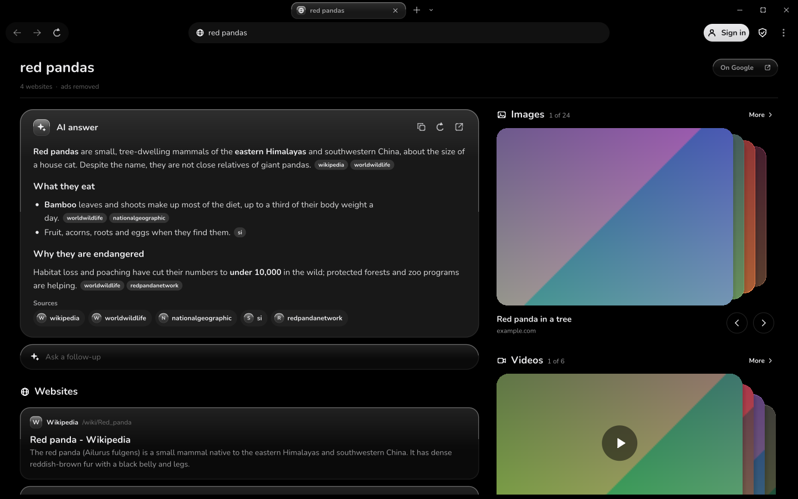
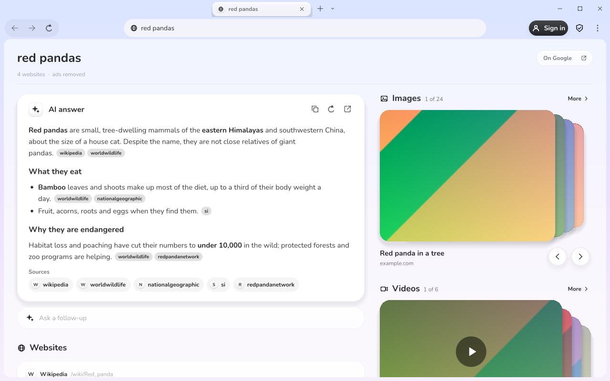
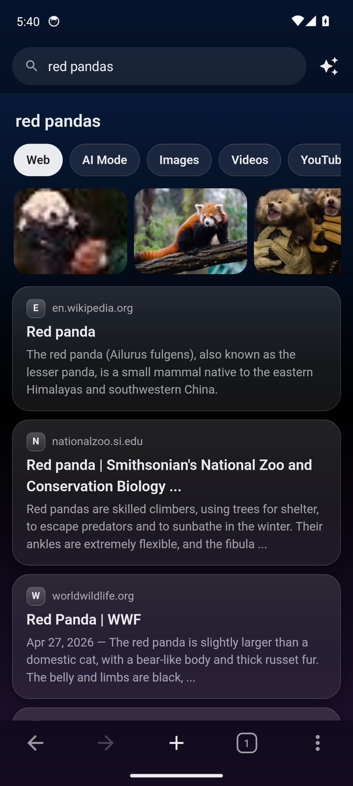
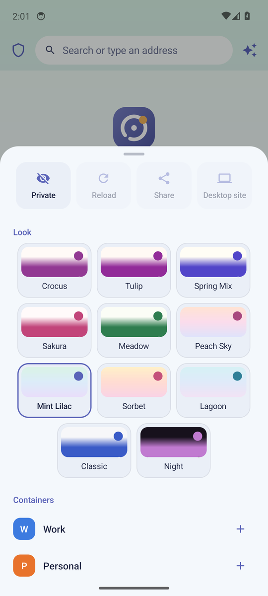
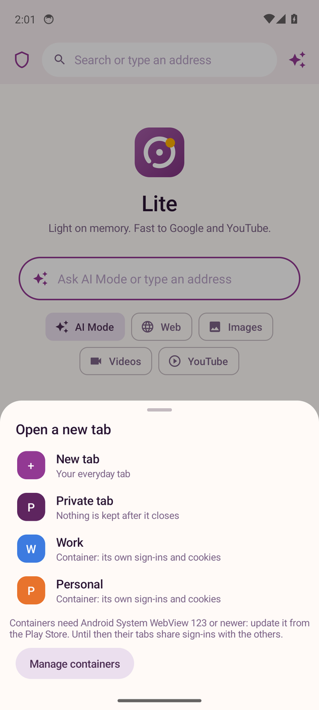

<p align="center">
  
</p>

<h1 align="center">Iris</h1>

<p align="center"><i>Formerly Lite Go. Iris is the Greek goddess of the rainbow, who carries light between worlds.</i></p>

<p align="center">
  <b>A light, fast browser written in Go.</b><br>
  The interface is drawn with Gio. Pages are shown by the web view your system already has.
</p>

<p align="center">
  
  
  
  
  
</p>

<p align="center">
  <a href="#what-it-does">Features</a> ·
  <a href="#shortcuts">Shortcuts</a> ·
  <a href="#platforms">Platforms</a> ·
  <a href="#build">Build</a> ·
  <a href="#how-it-is-made">How it is made</a>
</p>

<p align="center">
  
</p>

---

## Why Iris

Most browsers spend your memory on their web engine without asking what each page is worth.
Iris puts a small Go program around the engine (WebView2 on Windows, which the system keeps
up to date; Chromium on Linux) that decides what each page may cost.

<table>
<tr>
<td width="33%" valign="top">

**Light**

A background tab rests within a minute: its page closes and its memory goes back, and it comes back where you left it. A closed tab frees its memory at once. Nothing runs in the background.

</td>
<td width="33%" valign="top">

**Fast**

Compact tabs on top, one slim bar under them, and a new tab page drawn by Iris itself:
the name and a search, nothing else.

</td>
<td width="33%" valign="top">

**Clean**

Ads, trackers, cookie notices and tracking links are removed. Google searches are shown on
a page of Iris's own, in your theme. No bookmarks, no tiles, no feeds.

</td>
</tr>
</table>

## A look

<table>
<tr>
<td width="50%"></td>
<td width="50%"></td>
</tr>
<tr>
<td align="center"><sub><b>New tab.</b> The name and a search.</sub></td>
<td align="center"><sub><b>Split view.</b> Two pages, one divider to drag.</sub></td>
</tr>
<tr>
<td width="50%"></td>
<td width="50%"></td>
</tr>
<tr>
<td align="center"><sub><b>Downloads.</b> A ring on the icon, a list at the side.</sub></td>
<td align="center"><sub><b>Sandbox.</b> Unsafe addresses are stopped first.</sub></td>
</tr>
<tr>
<td width="50%"></td>
<td width="50%"></td>
</tr>
<tr>
<td align="center"><sub><b>Lite results.</b> The AI answer with named sources, glass cards for the websites, stacks of pictures and videos.</sub></td>
<td align="center"><sub><b>Tabs.</b> A compact strip on top, centered.</sub></td>
</tr>
<tr>
<td width="50%"></td>
<td width="50%"></td>
</tr>
<tr>
<td align="center"><sub><b>The menu.</b> Tools, then the settings in sections that open in place.</sub></td>
<td align="center"><sub><b>Glass themes.</b> Shared with Ember.</sub></td>
</tr>
</table>

<table>
<tr>
<td width="33%"></td>
<td width="33%"></td>
<td width="33%"></td>
</tr>
<tr>
<td align="center"><sub><b>Lite for Android.</b> Lite results.</sub></td>
<td align="center"><sub>Eleven palettes.</sub></td>
<td align="center"><sub>Hold + for private and container tabs.</sub></td>
</tr>
</table>

<sub>The desktop pictures are drawn by the test suite with Iris's software renderer (page areas
and thumbnails are placeholders); the Android ones come from an emulator.</sub>

## What it does

### Browsing

| | |
|---|---|
| **Lite results** | Google searches on a page of Iris's own, minimal like Kagi. At the top, the AI answer, written for you (by your name, warm, insight over hype), with each citation named by its site. Then the websites as clear glass cards that keep loading as long as Google has relevant ones, ranked by source quality (references, official sites and docs rise; shops, coupon farms and listicles sink), and stacks of picture cards (each in its own shape, sharp at the front) and video cards. "On Google" shows the original. Type `yt ` before words to search YouTube. |
| **Your say over sites** | Raise, lower or hide any site in your results, and it stays that way. |
| **Websites in new tabs** | A result, an address typed while a site is open, or a link to another website opens in a new tab beside the one you are on. Back from its first page (or closing it) returns there. Sign-in steps stay in their tab. |
| **Ask AI** (Ctrl+J) | On any page, a side panel sends your question and the page's text (or your selection) to Google AI Mode and writes the answer with its sources. No API key. |
| **Split view** | Two pages side by side. The pane you click takes the keyboard and the address bar. |
| **Downloads** | A toolbar icon with a progress ring; a list with speed, time left, pause, resume, cancel, open and show in folder. |
| **One slim bar** | Back, forward and reload at the left, the address in the middle, then the shield and the menu. It narrows to what is needed on a small window. A Sign in button shows only while Iris is not signed in to Google. |
| **The menu** | Tools (private tab, history, downloads, reopen, split view, find, print, free memory), zoom, your name for the AI answers, and the settings in sections that open in place: appearance (the palettes, shared with Ember), shields and privacy, containers, memory, history and data, about and updates. |
| **The usual** | Find in page, zoom, print, a searchable history by day, reopen a closed tab, and the last tabs brought back at start (unloaded until you open them). |
| **Tabs** | A compact strip on top, centered, above the bar; tabs shrink to their icons as more open, and the strip scrolls with the wheel when they do not fit. The arrow beside + opens private, temporary, sandbox and container tabs. Containers keep their own sign-ins, each with an icon and a color. |

### Memory

| | |
|---|---|
| **The plan** | Background tabs are hidden at once and rest soon after (20 seconds on Saver, a minute on Balanced, ten on Speed): the page closes and gives its memory back, keeping its address, title and scroll position, so it comes back where it was (hydration). A closed tab frees its memory at once. Tabs playing sound or video (and for ten minutes after they pause) and YouTube tabs never rest. Chromium itself is trimmed: pages of one site share a process, at most three page processes run on 8 GB or less (five above), the back-and-forward page cache and Chromium's background services (updates, translate, media routing, crash reports) are off, and only the changed part of each frame is copied. Nothing is prepared ahead of time and nothing keeps running once the window closes. |
| **The balancer** | The tab in front (both, in split view) has priority. Every other page is told at once that nobody is looking, so the engine gives memory back. When the pages pass the budget, or the computer runs short, background pages sleep and then unload, oldest first. |

### Lite Shields

| | |
|---|---|
| **Filter lists** | EasyList, EasyPrivacy and uBlock filters, about 110,000 rules matched in microseconds, refreshed every few days, plus a built-in list of 100,000 domains. |
| **Adaptive** | A site is scanned on its first visits. Where three scans find nothing, the shield stands by and the site's requests go straight to the network; where something is found, it stays on. Clean sites are scanned again every 15 visits or three days. |
| **What ads leave behind** | Empty boxes and cookie notices are hidden. Tracking parameters are cut from links, tracking redirects skipped, AMP pages opened at the source. |
| **Fingerprinting** | Canvas, audio and hardware details vary slightly per site and session. Sign-in and human-check pages are left alone. |
| **H.264 videos** | Iris's Chromium has no H.264 or AAC (the free builds leave them out). When a video in that format cannot play (LinkedIn, X, many news sites), Iris converts it on the fly with the system's ffmpeg, or GStreamer, through a small relay on the computer only, and the page plays that. |
| **YouTube** | YouTube shows a warning when it sees an ad blocker, so on YouTube the shield blocks nothing and Iris does not touch the player's data. When an ad starts, Iris mutes it, plays it at 16× to its end and presses Skip; the video then goes on with its own sound and speed. The ad boxes around the videos are hidden, and if the warning still comes, it is closed and the video resumes. YouTube tabs never rest. |
| **Never broken** | Sign-in, messaging, human checks and YouTube playback are never blocked. Pictures, video, style sheets and fonts always load: the shield checks scripts and data requests, where ads and trackers start, and never blocks a whole hosting network. |

### Safety

| | |
|---|---|
| **HTTPS-only** | Addresses go straight to HTTPS. A site without it is stopped before it loads. |
| **Sandbox** | A site without HTTPS, or an address that looks dangerous (a known name on someone else's site, a real site hidden behind an `@`, a bare network address, look-alike letters), can be opened in a throwaway session: no downloads, no camera, microphone, location, notifications or clipboard, nothing saved, wiped when the tab closes. The check reads the address only; it is not a malware scanner. |
| **Checks itself** | At every start Iris compares its program file with the SHA-256 recorded at install and warns if they differ. This catches accidents and careless changes. The Store package is stronger: Windows keeps it read-only and verifies it. |
| **Private by kind** | Private tabs share one session never written to disk. A temporary tab is a fresh session of its own. History is never kept for either. |

## Shortcuts

| Keys | Action | Keys | Action |
|---|---|---|---|
| `Ctrl` `T` | New tab | `Ctrl` `F` | Find in page |
| `Ctrl` `Shift` `N` | Private tab | `Ctrl` `H` | History |
| `Ctrl` `W` | Close tab | `Ctrl` `P` | Print |
| `Ctrl` `Shift` `T` | Reopen closed tab | `Ctrl` `Shift` `S` | Split view |
| `Ctrl` `L` | Address bar | `Ctrl` `Shift` `D` | Downloads |
| `Ctrl` `J` | Ask AI | `Ctrl` `+` `-` `0` | Zoom |
| `Ctrl` `Tab` | Next tab | `Ctrl` `M` | Mute tab |
| `Ctrl` `1`...`9` | Go to tab | `Alt` `Left` / `Right` | Back, forward |
| `Ctrl` `R` / `F5` | Reload | `F11` | Full screen |
| `Ctrl` `,` | Menu | | |

They work while a page has the keyboard too.

## Platforms

| System | Web engine | Status |
|---|---|---|
| Windows 10 and 11 (x64, ARM64) | Microsoft Edge WebView2, through Iris's own bindings in pure Go (no cgo) | Runs. The newest features (downloads, split view, sandbox, the menu) are covered by tests with a stand-in engine and still need a pass on a real PC. |
| Linux on Wayland (niri, KDE, Sway, Hyprland and others) | Chromium, through CEF (the Chromium Embedded Framework), which Iris carries | Built and started on Wayland on Debian 12 and 13, Ubuntu 22.04 and 24.04, Fedora 42 and 43, openSUSE Tumbleweed and Arch on every push, with a VP9 video playing. Packages: .deb, .rpm, AUR, Nix and .tar.gz. (The Flatpak is paused until Chromium is packaged for its sandbox.) |
| Android 8 and newer | Android System WebView | **Lite for Android**, a separate app in Kotlin (`android/`): shields, Lite results for Web searches, tabs, containers (WebView 123 or newer), eleven palettes, phone and tablet layouts, and sync with the computer. `Lite-android.apk` is in each release. |

On Windows the engine comes with the system. On Linux, Iris carries its own Chromium
(Chromium 156, from CEF) in `/usr/lib/lite-go-browser`, and each release brings the newer one.

On Linux the window is a GTK window, because Wayland does not let one program's surface sit
inside another's. GTK owns the window, Gio's GPU renderer draws the interface into a GL area
in it, and Chromium draws each page off screen: Iris paints the page into its own area of
the window and passes it the pointer, the wheel and the keys. One window, one connection to
the display. Chrome extensions do not run in an embedded Chromium like this one; the shields
do the work of an ad blocker.

## Install on Linux

Every release has a `.deb`, an `.rpm` and a `.tar.gz` for any distribution (each about 110 MB: Chromium is inside). Iris needs glibc 2.35 or newer (Debian 12, Ubuntu 22.04, Fedora 36 or later) and a Wayland session.

**Debian, Ubuntu, Linux Mint** (from the signed repository, so updates come with the system's):

```sh
curl -fsSL https://tulip-labs.github.io/Lite-Go-Browser/lite-go-browser.gpg | sudo tee /usr/share/keyrings/lite-go-browser.gpg >/dev/null
echo "deb [signed-by=/usr/share/keyrings/lite-go-browser.gpg] https://github.com/Tulip-Labs/Lite-Go-Browser/releases/latest download/" | sudo tee /etc/apt/sources.list.d/lite-go-browser.list
sudo apt update && sudo apt install lite-go-browser
```

The packages are too big for GitHub Pages, so the apt repository is made of the latest
release's files. If you added the old `tulip-labs.github.io/.../deb` line, version 1.0.8 moves
it over when it installs.

**Fedora**

```sh
sudo dnf config-manager addrepo --from-repofile=https://tulip-labs.github.io/Lite-Go-Browser/lite-go-browser.repo
sudo dnf install lite-go-browser
```

**openSUSE**

```sh
sudo zypper addrepo https://tulip-labs.github.io/Lite-Go-Browser/lite-go-browser.repo
sudo zypper install lite-go-browser
```

**Fedora Atomic** (Silverblue, Kinoite): `sudo curl -fsSLo /etc/yum.repos.d/lite-go-browser.repo https://tulip-labs.github.io/Lite-Go-Browser/lite-go-browser.repo`, then `rpm-ostree install lite-go-browser`, and restart. Updates come with `rpm-ostree upgrade`.

**Arch**: download the `PKGBUILD` from the latest release into an empty folder and run `makepkg -si` (an AUR package is planned).

**Nix**: `nix profile install github:Tulip-Labs/Lite-Go-Browser`, or try it with `nix run github:Tulip-Labs/Lite-Go-Browser`.

**Any distribution, no root**: unpack `LiteGo-linux-x86_64.tar.gz` and run `./install.sh` (it installs to `~/.local/lib/lite-go-browser`, with `lite-go` in `~/.local/bin`).

The repository pages with these commands are at [tulip-labs.github.io/Lite-Go-Browser](https://tulip-labs.github.io/Lite-Go-Browser/).

**Updates.** Iris checks the latest GitHub release every few hours (Settings, About Iris; on by default) and checks each download against the release's `SHA256SUMS`. The `.tar.gz` copy updates by itself; `.deb` and `.rpm` copies download in the background and install with one click and your password. Copies from the AUR, Nix or rpm-ostree update the way those tools do.

## Build

**Windows.** Double-click `build-litego.bat`. It installs Go with winget if needed, runs the
tests and makes:

| File | What it is |
|---|---|
| `dist\Lite Go Setup.exe` | The installer: current user only, no administrator rights |
| `dist\Lite Go\Lite Go.exe` | The portable app (also `dist\LiteGo-portable.zip`) |
| `dist\LiteGo.msixbundle` | For the Microsoft Store, packed without the Windows SDK |

No C compiler is needed, and builds stay well under 2 GB of memory.

**Linux.** On Linux, `./build-litego.sh` builds Iris for Linux first and then the Windows
files. It fetches Chromium (CEF, about 300 MB, checked against its SHA-1) into `third_party/cef`
once, checks for the build tools and GTK development files and says what to install if
something is missing:

```sh
# Fedora
sudo dnf install gcc pkgconf gtk3-devel libepoxy-devel curl bzip2
# Fedora Atomic (Silverblue, Kinoite): build inside a toolbox
toolbox create && toolbox enter   # then the Fedora line above
# Debian, Ubuntu
sudo apt install gcc pkg-config libgtk-3-dev libepoxy-dev curl bzip2
# Arch
sudo pacman -S gcc pkgconf gtk3 libepoxy curl bzip2

./build-litego.sh             # Linux (dist/linux, dist/LiteGo-linux-x86_64.tar.gz), then Windows
./build-litego.sh linux       # Linux only
./build-litego.sh windows     # Windows only
./build-litego.sh install     # build for Linux and install for you: ~/.local and the app list
./build-litego.sh uninstall
```

Each release also has `LiteGo-linux-x86_64.tar.gz`: unpack it and run `./install.sh`. It carries
Chromium and needs only GTK 3 and the libraries every desktop has.

**Tests.**

```sh
go test ./core ./shell ./shields ./ui
SHOTS=shots go test ./shell   # also writes screenshots of every screen
```

<details>
<summary><b>Getting it onto other PCs without warnings</b></summary>

<br>

Windows warns about programs not signed by a known publisher. For a free app
the clean route is the Microsoft Store:

1. Registration is free for individual developers: create an account in Partner Center.
2. Reserve the name "Lite Go", then copy *Package/Identity/Name* and *Publisher* from
   Product identity into `packaging/msix.json`.
3. Build and upload `dist\LiteGo.msixbundle`. The Store signs it, so it installs without
   warnings and updates itself.

The whole submission, with the listing texts, is in [packaging/STORE.md](packaging/STORE.md).

`packaging/test-install.ps1` signs a package with a certificate made on your own PC, to try
the MSIX first. The setup `.exe` and the portable app stay unsigned: SmartScreen shows
"Windows protected your PC" (More info, Run anyway) until a code-signing certificate is
used, which is a paid service.

</details>

## How it is made

```
cmd/litego          the program: window, resident process, system hooks
    |
  shell             the interface: tabs, split view, address bar, new tab page,
    |               results, downloads, history, the balancer, the side panel
    |
    +-- ui, giox    the interface toolkit (Material 3, liquid glass) and its Gio backend
    +-- core        rules with no window: search, shields, adaptive scans, unsafe
    |               addresses, HTTPS, the memory plan, history, settings
    +-- shields     filter lists, hiding rules, link cleaning, fingerprinting
    +-- webview     one small interface over two engines:
                      WebView2 from pure Go (COM vtables, profiles, sandbox, suspend,
                      request filtering, downloads)
                      Chromium (CEF) through cgo, off screen in a GTK window (Linux)
```

| Folder | What it is |
|---|---|
| `setup`, `cmd/litego-setup` | The installer: its screens, install, update and removal |
| `raster` | A software renderer, for tests and screenshots |
| `packaging`, `tools` | MSIX packing and build helpers |

The web engine sits behind `webview.Engine` and `webview.View`, so everything above it is
the same on both systems, and the whole interface can be tested with a stand-in engine.

## License

[GNU General Public License 3.0](LICENSE). You may use, share and change Iris, and sell
copies; copies and changed versions must keep the copyright notice, stay under the GPL and
come with their source. See also [NOTICE](NOTICE) and
[THIRD_PARTY_NOTICES.md](THIRD_PARTY_NOTICES.md). What Iris does with data: [PRIVACY.md](PRIVACY.md).

<p align="center">
  <sub>Tulipan Labs · Cesar Jose Luis Torrecilla Gelvez</sub>
</p>
